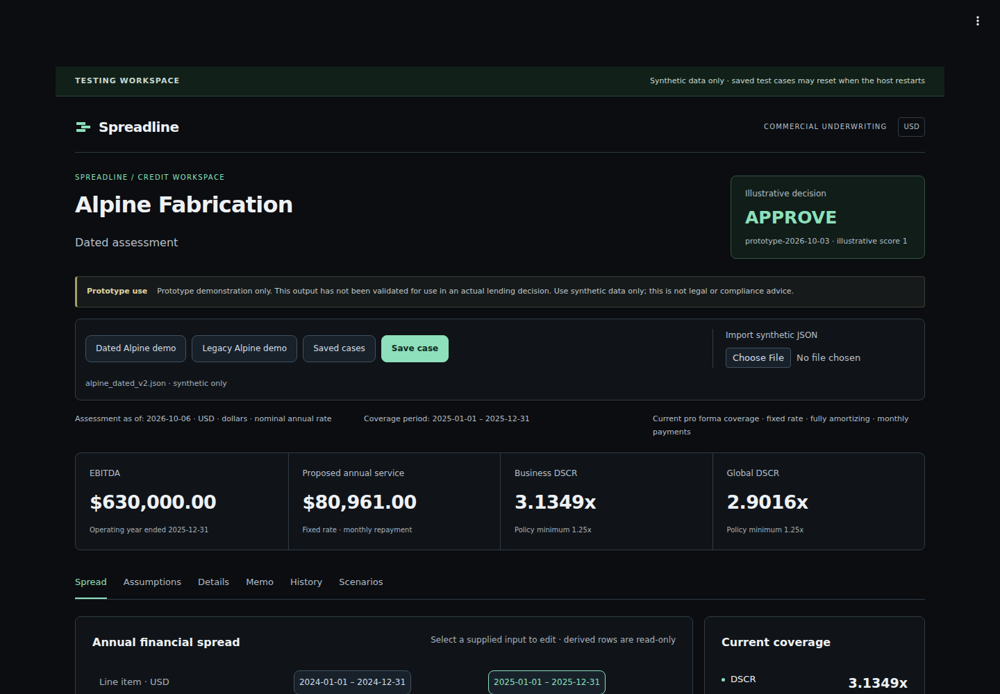

# Streamlit testing host

Spreadline can run as one Streamlit app, hosted on Render (previously Streamlit
Community Cloud). Its React workspace is
packaged as a v2 custom component; a bounded Python bridge invokes the existing
FastAPI ASGI application inside the same deployment. Financial formulas, intake
validation, authentication middleware, policies and saved-write receipts remain
owned by the existing backend. The standalone Vite application remains supported.

This is a synthetic-data, single-operator testing environment. Browser drafts and
responses are session-local. Saved synthetic cases are intentionally shared by
everyone using the configured operator credential: trusted testers behind the
access password, or any visitor when public access is on. The recorded actor
identifies that credential, not an independently verified human or tenant.



## Local run

Use Python 3.12 and Node 24 for the component build. From repository root:

```bash
python3.12 -m venv backend/.venv
source backend/.venv/bin/activate
python -m pip install -r backend/requirements-dev.txt -c backend/constraints-dev-py312.txt
npm --prefix frontend ci
npm --prefix frontend run build:streamlit
python -m pip install -r streamlit_app/requirements.txt
```

Copy `.streamlit/secrets.example.toml` to the ignored `.streamlit/secrets.toml`.
Use a cryptographically random operator token from your credential manager
meeting the existing 32–4,096 ASCII Bearer-character contract. Use a separate
testing credential; never place it in frontend variables or a commit. Set
`SPREADLINE_ACCESS_PASSWORD` to a viewer password of at least 16 characters that
differs from the token. For local testing, enable the flag and run:

```bash
streamlit run streamlit_app/app.py --server.address=127.0.0.1
```

Open `http://127.0.0.1:8501` and enter the access password. The component uses the
host credential on the Python side; it does not ask the browser for that credential
or start a second API server. For iterative development, install the component in editable mode with
`python -m pip install -e streamlit_app/component --no-deps`, then rebuild after
frontend changes. A normal installation includes the built assets in its wheel;
reinstall that package after rebuilding if it is not editable.

## Access password

Render has no viewer sign-in, so the app has its own gate. When the workspace is
enabled without public access (below), `streamlit_app/app.py` requires `SPREADLINE_ACCESS_PASSWORD`: at least
16 characters, different from `SPREADLINE_API_TOKEN`. A missing or invalid value
fails closed with an error that names the variable without showing it. Until a
viewer enters the password, the app opens no case store and the bridge
dispatches nothing.

The password is shared by trusted testers and compared in constant time. Access is
held in server-side session state, so a reload or new tab asks again. The gate
limits who can use the operator credential; it does not identify individual
viewers. Rotate the password by changing the variable, which restarts the service
and ends every session.

### Public access

`SPREADLINE_PUBLIC_ACCESS=true` skips the access password, and then
`SPREADLINE_ACCESS_PASSWORD` is not required. Any other value, including an
unset variable, keeps the gate. With public access on, anyone with the URL works
as the configured operator: they can list, open, change and save every case in
the shared store. A caption above the workspace says so and asks visitors not
to enter real borrower information. The operator token still stays on the server, and the
bridge limits below still apply. Use public access only with synthetic data.

## Render deployment

`render.yaml` is a Render Blueprint for one free Python web service named
`spreadline-testing`, built from `main`:
- `autoDeployTrigger: checksPass` deploys a `main` commit only after its GitHub
  Actions checks pass.
- `.python-version` pins Python 3.12. Render otherwise defaults to a newer
  version that these pins were not resolved for.
- The build runs from repository root:
  `pip install -r streamlit_app/requirements.txt`, then a forced reinstall of
  `./streamlit_app/component`, so each build serves the committed bundle.
- The start command binds Streamlit to `0.0.0.0:$PORT` and runs headless. Render
  health-checks `/_stcore/health`.

Environment variables:
- `SPREADLINE_TESTING_ENABLED` is prompted at creation (`sync: false`), and later
  syncs leave it unchanged.
- `SPREADLINE_OPERATOR_ID` is `render-testing`.
- `SPREADLINE_PUBLIC_ACCESS` is `true`, so the Render service is public. Each
  Blueprint sync reapplies this value; to restore the password, change it to
  `false` in `render.yaml` and merge.
- Render generates `SPREADLINE_API_TOKEN` and `SPREADLINE_ACCESS_PASSWORD` (random
  256-bit base64 values). The token is used only on the server; nobody needs to
  read it. The password is unused while public access is on; when the gate is
  restored, testers get it from the service's **Environment** tab.

Rollout:
1. In the Render dashboard, choose **New → Blueprint**, connect this repository
   and select `main`. Enter `false` for `SPREADLINE_TESTING_ENABLED` and apply.
2. Confirm the build used Python 3.12, `/_stcore/health` returns 200, and the URL
   shows only the disabled setup screen.
3. Set `SPREADLINE_TESTING_ENABLED` to `true`. After the redeploy, confirm the
   access screen appears and rejects a wrong password. The committed Blueprint
   has public access on, so a new service shows the start screen here instead;
   set `SPREADLINE_PUBLIC_ACCESS` to `false` first to verify the gate.
4. Unlock with the generated password (not needed with public access) and run
   the hosted smoke test below. Record the deployed commit and URL here.
5. To open the service to the public, merge `SPREADLINE_PUBLIC_ACCESS: "true"` in
   `render.yaml`. Confirm the URL opens on the start screen with the public demo
   caption and no access screen.

The service is at <https://spreadline-testing.onrender.com/>. On October 27, 2026
it deployed `a3a120af83f02adceab7e227fc0d666e8cb5216d` after CI passed;
`/_stcore/health` returned 200, the served component bundle matched the
committed `index-DR-GjOK7.js` digest, and the access screen loaded. The full
smoke test below was not repeated for that deploy.

The free instance sleeps after 15 minutes without traffic and takes about a minute
to wake. Its filesystem is temporary: a restart, sleep or redeploy deletes the case
store. Persistent records would need a paid instance with a disk mounted at
`SPREADLINE_CASE_DB`.

## Previous host: Community Cloud (retiring)

The Community Cloud app remains available until the Render deployment passes the
hosted smoke test; it is then deleted from Community Cloud. Its deployment record
is kept below.

### Community Cloud deployment

1. Use the tested repository branch. The entry point is `streamlit_app/app.py`.
2. Select Python 3.12 in advanced deployment settings. Community Cloud discovers
   `streamlit_app/requirements.txt`; run paths and local package installation are
   relative to repository root.
3. Initially leave secrets unset. The app shows only a disabled setup screen and
   does not create a case store.
4. Set sharing to **Only specific people can view this app**. Check the app in an
   uninvited browser before enabling the workspace. A public repository produces
   a public app by default. Community Cloud currently allows one private app per
   account; confirm availability rather than using a public fallback.
5. Supply these **top-level** managed secrets through app settings:

   ```toml
   SPREADLINE_TESTING_ENABLED = "true"
   SPREADLINE_API_TOKEN = "<private testing credential>"
   SPREADLINE_OPERATOR_ID = "streamlit-testing"
   ```

6. Recheck both permitted and uninvited access after enabling. The enable flag is
   an operator-controlled rollout switch; it does not implement authentication
   or independently verify Cloud privacy settings. The private-app access
   boundary is required when the server credential is configured.
7. Run the hosted smoke test below and record the deployed commit and URL.

No credential or case database belongs in the public component asset directory.
Only generated JavaScript and a build manifest are packaged there. The root
Streamlit configuration uses supported theme and viewer-toolbar settings.

### Verified testing deployment

The app was deployed on October 16, 2026 at
<https://spreadline-testing.streamlit.app/> from
`codex/streamlit-testing-workspace`, initially at commit
`ceff5d9f235f4c923e9d5bf9f5e11f4570f4aee5`, using Python 3.12 and
`streamlit_app/app.py`. The saved Sharing setting was reopened and confirmed as
**Only specific people can view this app** before enabling the workspace. No
additional viewers were invited. An anonymous HTTP request redirected through
Community Cloud authentication; a complete uninvited interactive browser test
was not performed.

The hosted smoke test edited synthetic revenue from $4.2 million to $4.3 million,
verified EBITDA of $730,000 and DSCR of 3.6325, saved revision 1, reloaded, and
reopened the same stored receipt and values. Selecting the earlier spread column
kept current coverage unchanged. A 10% revenue downside preview produced
$300,000 EBITDA and 1.4928 DSCR, then saved and reopened as an original comparison
without changing the baseline. The live desktop layout was visually reviewed.

On the initial build, Community Cloud replaced PyArrow 26.0.0 with 24.0.0. The
runtime constraint now matches that working host version; the 23 Python host
tests and three packaged browser workflows also passed with PyArrow 24.0.0.

### Updating the hosted app

Deploy by fast-forwarding `codex/streamlit-testing-workspace` to a `main` commit
whose CI passed; Community Cloud builds that branch. The workspace reaches the host
as an installed copy of `streamlit_app/component` with its built assets inside, so
new code alone does not replace it. On October 17, 2026, fast-forwarding to
`0d3eefa` (light theme, decomposed views) and then rebooting the app still served
the previously installed workspace, while reinstalling the package locally with
uv or pip picked up the new bundle.

`npm --prefix frontend run build:streamlit` therefore also rewrites the last line
of `streamlit_app/requirements.txt` with the bundle file name and SHA-256, and
`python3 scripts/streamlit_assets.py check` fails when that stamp is stale. Every
new bundle reaches the host as a dependency change. Changes to
`.streamlit/config.toml`, such as the theme, apply when the app restarts.

After an update, open the app and confirm the expected workspace. If it still
shows an older version, open **Manage app** and check the logged branch and
dependency installation. Repeat the hosted smoke test before recording a newly
deployed commit here.

## Temporary storage and recovery

The default store is `.spreadline-data/streamlit/cases.sqlite3`, outside served
assets and ignored by git. `SPREADLINE_CASE_DB` can select another operator-owned
path. Neither Render's free instance nor Community Cloud keeps local files. Case saves
and comparisons therefore last only as long as this testing store; a host reset
can delete them. Do not rely on this host for real records.

A private generation marker binds recovery to the current store. A missing,
replaced or mismatched store blocks dispatch. After a reset, restart the host
and review records and recovery tracking; an old pending write cannot silently
replay into a new database. Existing database schemas and archived records are
not migrated by this integration.

The embedded journal has a separate browser namespace from the standalone app.
It preserves the exact command, UUID operation key and edit ETag before sending
a saved write. Reload and Streamlit reruns never automatically retry that write.
Unknown execution failures remain uncertain even if a commit may have happened;
**Retry exact write** retains the original operation identity. Keep the existing
explicit conflict review and discard procedures in [WORKSPACE.md](WORKSPACE.md).

The bridge permits only the workspace's own routes:
- assessment;
- both analysis routes;
- case, replay and scenario routes.

Its query rules are:
- `GET /cases` alone may add the listing's `q`, `outcome` and `sort`;
- other GET routes page only with `limit` and `after`;
- POST routes accept no query string.

It rejects arbitrary URLs, browser-supplied Authorization,
unexpected headers, invalid generations and oversized commands. It preserves raw
JSON text through existing intake. At most four requests are active per browser
batch, with a 1,000,000-byte command body limit, a 16 MiB individual response cap,
a 20 MiB aggregate response budget and a 30-second dispatch deadline. A timeout
does not establish that a write rolled back.

## Build and verification

`npm --prefix frontend run build:streamlit` cleans the generated directory,
builds the shared React source, and records the exact hashed entry file, bundle
digest and source digest in `manifest.json`. The installed Python component
registers that exact entry. `python scripts/streamlit_assets.py check` rejects
stale or extra assets. Commit generated assets with source changes so Community
Cloud never needs to run a Node build during startup.

With dependencies installed and the Python environment active:

```bash
./scripts/run_all_checks.sh
bash scripts/run_streamlit_checks.sh
```

The existing suite checks the financial engine, independent reference formulas,
precision, standalone browser contracts, saved records, conflicts and scenarios.
The additional suite checks the embedded raw transport, authentication boundary,
response limits, rerun deduplication, reset identity, disabled rollout, keyboard
focus inside Shadow DOM, the start screen on a fresh session, closing the More
menu by a click outside it inside the shadow root, separate drafts and explicit
recovery after reload.
Browser runs own fresh synthetic temporary stores and refuse an existing server
on their test port. An installed Chromium can be selected with the existing
`PLAYWRIGHT_CHROMIUM_EXECUTABLE_PATH` override.

After the workspace layout and analysis (PR 3, [verification](VERIFICATION.md)),
merged with the bundle-stamp change, the same commands passed:
- 1,501 backend tests;
- 34 testing-host tests;
- 323 standalone browser and contract checks;
- four packaged Streamlit browser workflows;
- eleven exact-decimal checks.

After the analysis services ([verification](VERIFICATION.md)), the same commands
passed:
- 1,501 backend tests;
- 29 testing-host tests;
- 237 standalone browser and contract checks;
- three packaged Streamlit browser workflows;
- five exact-decimal checks.

Historical: the original host verification on October 16, 2026 passed 948
existing backend tests, 23 testing-host tests, 189 standalone browser/contract
checks, three packaged Streamlit browser workflows, and five exact-decimal
presentation checks. The
independent reference and precision gates, Python lint/strict typing, both
frontend builds, dependency consistency and the npm audit also passed. Desktop
and 390 px layouts were visually reviewed. Scenario retention browser checks
compare receipt metadata with the immutable original-record endpoint, avoiding
dependence on Chromium retaining a consumed streamed POST response body.

The CI Streamlit job builds with Node 24, checks committed asset freshness,
installs the package normally, and tests its real browser workflow. The original
frontend job continues to use Node 22. Screenshots in `frontend/test-results`
are local verification output, not published customer data.

## Hosted smoke test and rollback

- Confirm the access boundary before using configured operations. With the gate,
  the access screen appears first and rejects a wrong password. With public
  access, the start screen appears directly with the public demo caption.
- A fresh session opens on the start screen with nothing evaluated. Choose
  **Try the example case**; inspect the decision bar, KPI tiles and Overview,
  then select an earlier spread column. The current coverage period must remain
  explicit.
- Open **More**: switch the theme, confirm the page restyles inside the host, and
  close the menu with a click outside it.
- Edit an input, save with a rationale, reload and reopen the original revision.
- Preview a scenario; confirm projected results do not replace the baseline.
- Test reconnect and exact recovery behavior with synthetic data. Check that
  operator credentials are absent from browser-visible data and logs.
- Inspect desktop/mobile layouts, dialog keyboard focus, and browser/server
  errors. Measure cold startup separately from warm requests.

Rollback selects the prior tested source and matching generated assets, then
rebuilds the deployment. On Render, roll back to an earlier deploy from the
service's **Events** page, or revert the commit on `main`. It does not recover a deleted temporary database. If
records must survive resets, host the existing API and SQLite database on
persistent storage before depending on them; that is a separate deployment
change rather than an implicit database migration.
